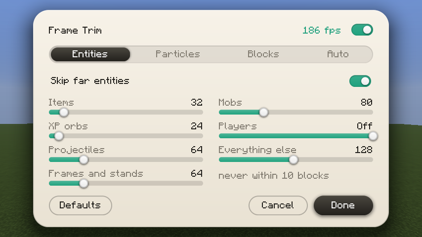
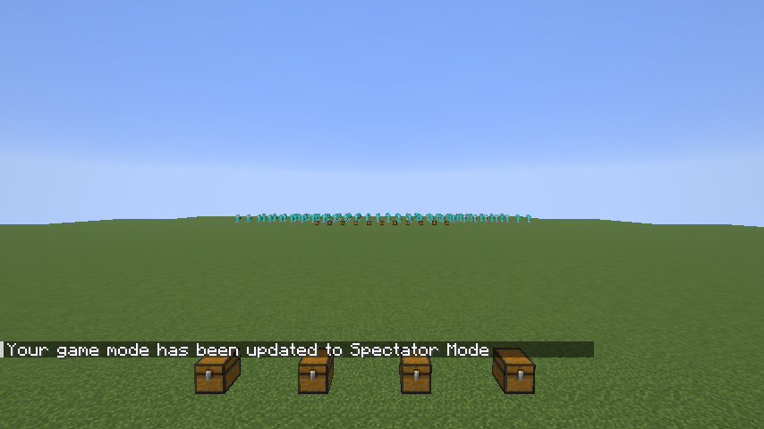
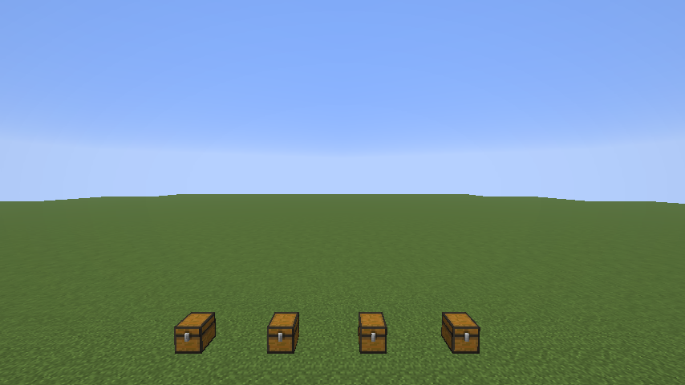

# Frame Trim

more fps by skipping what is too far away to matter. every kind of thing gets its own distance limit, and an adaptive mode tightens all of them when your fps drops.

client side fabric mod for 1.21.11, 26.1 and 26.2. press **K** to open the settings (press it again to close, rebind it in Controls), or use Mod Menu. the settings menu is built into the mod, it only needs fabric api.

- **entities**: separate limits for items, xp orbs, projectiles, item frames and armor stands, mobs, players and everything else. nothing within 10 blocks is ever hidden. players default to no limit
- **particles**: new particles further than a distance are never created, and there is a cap on how many can be created per tick
- **block entities**: chests, signs, banners, beds and skulls further than a distance are not drawn
- **adaptive quality**: set a target fps. when you stay under it every limit shrinks step by step, down to a floor you choose, and it grows back when there is room
- a live fps readout and a count of what was skipped in the settings

this is a client side render skip. it never changes what the server sends you and it does not touch hitboxes, so what is hidden is only what is not drawn.

## download

| jar | minecraft |
|---|---|
| `frame-trim-mc1.21.11-1.0.0.jar` | 1.21.11 |
| `frame-trim-mc26.1-1.0.0.jar` | 26.1 |
| `frame-trim-mc26.2-1.0.0.jar` | 26.2 |

on the releases page. fabric loader 0.16 or newer, fabric api.

## how much does it give

it depends on what is around you. on a plain world there is nothing far away to skip, so there is little to gain. it helps in busy places: farms, storage rooms, mob grinders and big builds full of armor stands, item frames and chests. in a stress scene of 420 armor stands and 320 chests between 60 and 100 blocks away the frame rate went from about 180 to about 620 on my machine. treat that as the best case, not a promise. skipping far particles did not change the frame rate in my particle scene, so that option is only for very large effects, and you can switch it off.

all rights reserved. made by wysss.
